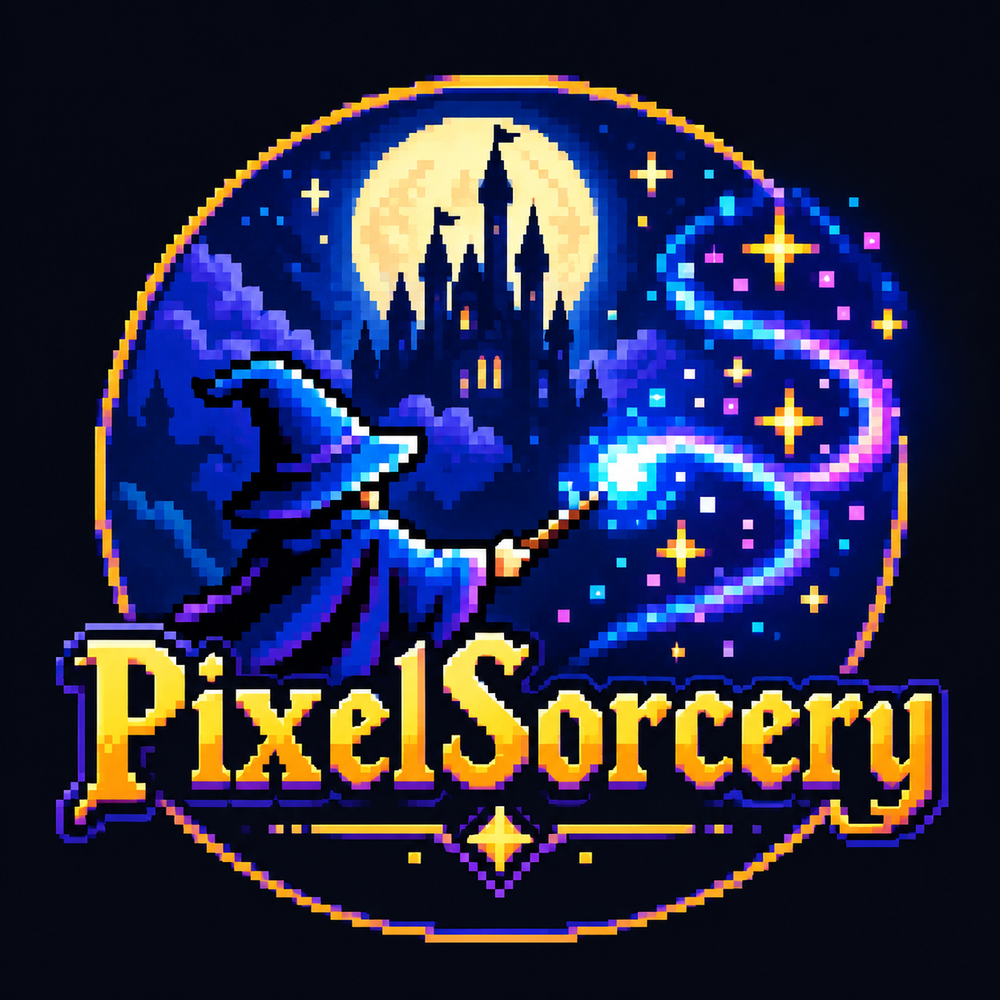

# PixelSorcery



**A hobbyist project.** PixelSorcery is made for fun and for preservation research in spare
time, with no company and no commercial aim behind it. It is not
affiliated with or endorsed by Sega, Disney or any other rights holder. Its own code is free
for any **non-commercial** use (see [Licence](#licence)).

PixelSorcery turns Sega Mega Drive / Genesis games into **native programs**: it takes a
cartridge apart, rebuilds its 68000 and Z80 code as C (static recompilation) and runs it on its
own video, sound and input code, with no emulator in the loop. Every port is checked against
the original game running in Genesis Plus GX until the two agree at every controller poll.

**No ROMs and nothing derived from them are included** (no generated C, disassembly,
graphics, sound, recordings or disc images). Bring your own dumps; every tool reads them on
your machine at build time.

## Games covered

In the code, folders and scripts each game goes by a codename. This table is the only place
that maps them:

| Codename | Game | ROM file in `../roms/` |
|---|---|---|
| `sh1` | Sonic the Hedgehog (REV00) | `sh1.bin` |
| `sh2` | Sonic the Hedgehog 2 | `sh2.bin` |
| `sh3` | Sonic the Hedgehog 3 | `sh3.bin` |
| `shk` | Sonic & Knuckles | `shk.bin` |
| `sh3k` | Sonic 3 & Knuckles (lock-on) | `sh3k.bin` |
| `shk2` | Knuckles in Sonic 2 (Sonic & Knuckles + Sonic 2 lock-on) | `shk_sh2.bin` |
| `shk1` | Knuckles in Sonic 1 - our own: Knuckles' moves in Sonic 1, built from your Sonic 1 and Knuckles in Sonic 2 dumps | made by `./play.sh shk1` |
| `shbs` | Blue Sphere (Sonic & Knuckles + Sonic 1 lock-on, launcher only) | `shk_sh1.bin` |
| `coi` | Castle of Illusion Starring Mickey Mouse | `coi.md` |
| `qs` | QuackShot Starring Donald Duck (REV00) | `qs.md` |
| `qs-r1` | QuackShot Starring Donald Duck (REV01) | `qs_r1.bin` |
| `woi` | World of Illusion Starring Mickey Mouse and Donald Duck (Europe) | `woi.md` |
| `woi-us` | World of Illusion Starring Mickey Mouse and Donald Duck (USA) | `woi_us.bin` |
| `shcd` | Sonic CD (Mega CD; reference player and our compilation disc only) | your own disc |

## Instruction coverage

How sure we are without playing: every recording (self-checks, the owner's play sessions and
full-game TAS input runs) is replayed on the native port and on the original, once with all
of the game's code compiled and again with 30% of it sent through the interpreter. All of them
match the original **exactly at every controller poll**. The table measures how much of each
game that exercises (`engine/tools/kpi.py`, numbers from `docs/kpi/history.csv`,
2026-10-31 20:09):

| Code | Instructions recompiled | Run in verified replays | Left to the interpreter | Recordings that MATCH (compiled / mixed) | Controller polls verified |
|---|---:|---:|---:|---|---:|
| SH1 | 27,880 | 16,530 (59%) | 0 | 12/12 / 12/12 | 315,722 |
| SH2 | 55,333 | 33,683 (61%) | 0 | 21/21 / 21/21 | 1,515,102 |
| SH3 | 82,719 | 25,885 (31%) | 0 | 6/6 / 6/6 | 37,674 |
| SHK | 129,933 | 46,334 (36%) | 0 | 11/11 / 11/11 | 317,493 |
| SH3K | 172,469 | 61,029 (35%) | 0 | 38/38 / 38/38 | 3,616,273 |
| SHK2 | 45,166 | 23,648 (52%) | 0 | 10/10 / 10/10 | 47,393 |
| SHK1 | 36,057 | 10,101 (28%) | 0 | 2/2 / 2/2 | 26,754 |
| COI | 24,414 | 12,511 (51%) | 0 | 42/42 / 42/42 | 924,965 |
| QS | 23,762 | 12,381 (52%) | 0 | 15/15 / 15/15 | 210,855 |
| QS-R1 | 23,346 | 10,737 (46%) | 0 | 3/3 / 3/3 | 121,457 |
| WOI | 27,770 | 5,812 (21%) | 0 | 2/2 / 2/2 | 4,894 |
| WOI-US | 27,539 | 7,551 (27%) | 0 | 4/4 / 4/4 | 173,056 |
| **All** | **676,388** | **266,202 (39%)** | **0** | **all** | **7,311,638** |

- **Instructions recompiled:** 68000 instructions the recompiler turned into C.
- **Run in verified replays:** of those, the ones the original actually executed during a
  recording whose replay matched. That is code proven equal in behaviour, not just compiled.
- **Left to the interpreter:** instructions the original executed that the recompiler never
  found. Zero everywhere: every instruction seen running is recompiled. Code nobody has reached
  yet still runs, through a 68000 interpreter with an exact hand-over, so missing coverage
  costs speed, not correctness.
- Raising "run in verified replays" is the current work: static discovery, every act started
  from the games' level selects, and a novelty-seeking explorer, all automatic.

Below the games, each instruction is checked on its own (`engine/tools/isa/isa_check.py`):
the SingleStepTests 680x0 suite, 500 tests per instruction form, run through the C the
recompiler generates and through the interpreter, comparing registers, flags, memory, next PC
and cycle count. Both pass all 62,000 counted tests with no cycle difference. Tests that end
in an address error (an odd-address word access, which crashes a real console too) are left
out of the count; 491 cases where the suite's CPU differs from Genesis Plus GX are reported as
disputes, and there we follow Genesis Plus GX, the reference every replay is compared against.

## Native, no emulation

A port's executable (e.g. `games/sh2/build/sh2`) contains no emulator:

| Part of the console | In a native port |
|---|---|
| 68000 (game code) | Recompiled C, interpreter for code never found |
| Z80 (sound driver) | Recompiled C (`z80recomp`) |
| VDP (video) | Our renderer: `ps_vdp.c`, `ps_render.c`, Metal/SDL output |
| YM2612 + PSG (sound) | Our synthesis: `ps_synth.c` |
| I/O, pads, save RAM, lock-on | `ps_hw.c` |

Genesis Plus GX is linked only into the *oracle* builds (`<code>_oracle`, `genrecomp_trace`,
`genrecomp_ref`): it runs the original game so each port can be compared with it. It is never
part of what a player runs.

**Enhancements** on top of the original: widescreen up to 21:9 with the extra columns really
drawn, instant save states, a settings menu with controller mapping, cheats, modern water,
recorded sessions, collection launchers.

## Quick start (macOS)

```sh
git clone --recursive https://github.com/nico3185/pixel_sorcery.git PixelSorcery
cd PixelSorcery
brew install cmake ninja sdl2 python m68k-elf-binutils
python3 -m venv engine/.venv && engine/.venv/bin/pip install capstone numpy pillow librosa
mkdir -p ../roms        # your dumps, named as in the table above (or ROM=/path/to/rom)
./play.sh               # list the games
./play.sh sh2           # first run: recompile + build + self-check, then play
./play.sh coi --list    # recorded sessions
```

- **Controls:** arrows; Z/X/C = A/B/C; Return = Start; Esc quits. Gamepads work, and
  CONTROLLER SETUP in the settings menu (F1 or Tab) maps any pad.
- **Apps and launchers:** `engine/tools/make_app.sh sh2`, `./launch.sh` (the SH and DC
  shelves, one version of each game), `./launch.sh sh` or `./launch.sh dc` alone.
- **Check a port yourself:** `engine/tools/recomp.sh ../roms/sh2.bin games/sh2` (regenerate,
  build, self-check); `engine/tools/check.sh sh2 my_run.bk2` (any `.polls`/`.gmv`/`.bk2` ->
  MATCH or the first divergence).

**TUTORIAL.md** explains every tool: decompiling (static analysis + traced coverage),
recompiling, verifying side by side, the Mega CD disc builder and relocator.

## Layout

| Path | What |
|---|---|
| `engine/tools/recompiler/` | Analyzer, 68000 -> C generator, seeds, jump tables |
| `engine/tools/z80recomp/` | Z80 driver -> C |
| `engine/tools/trace_runner/` | GPGX tracer: coverage, ROM use, traps |
| `engine/tools/megacd/` | Mega CD disc builder, loader, relocator, game-select menu |
| `engine/src/` | Native runtime (video, sound, I/O, menus, sessions) + GPGX backend |
| `engine/ext/Genesis-Plus-GX/` | Submodule: the reference (oracle) and the reference player |
| `games/<code>/` | Per game: `recomp.json` (addresses, seeds, hooks), audio driver, glue |

## Licence

- **PixelSorcery's own code: [PolyForm Noncommercial 1.0.0](LICENSE).** Use, study, change
  and share it for any non-commercial purpose; no commercial use.
- **The engine started as a fork of [sp00nznet/genrecomp](https://github.com/sp00nznet/genrecomp)**,
  whose code stays under its MIT licence (`engine/LICENSE`).
- **Genesis Plus GX** (submodule, oracle builds only): its own non-commercial licence.
- **The games are not included and not covered by any of these licences.** Built ports,
  apps and discs contain code translated from your ROMs: play them yourself, never share or
  sell them.
- Third-party components, credits and trademarks: `NOTICE`.
